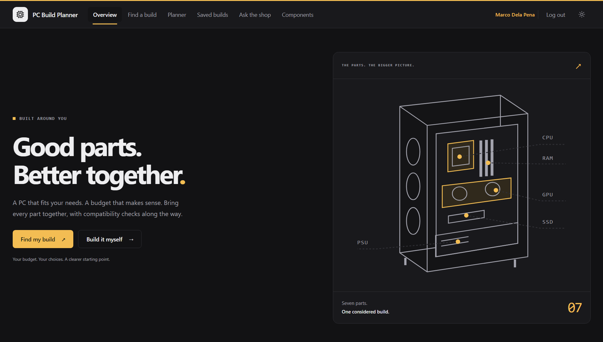
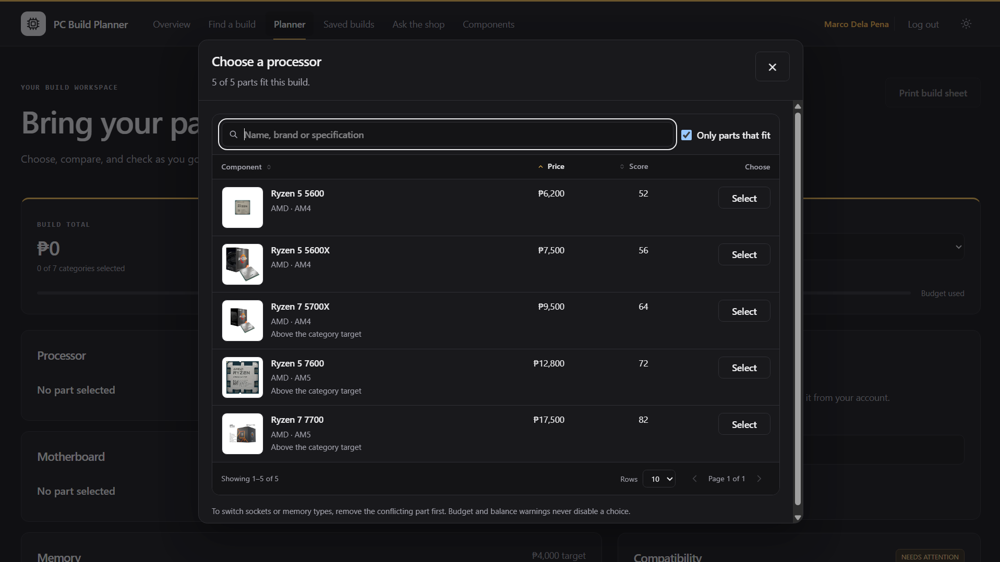
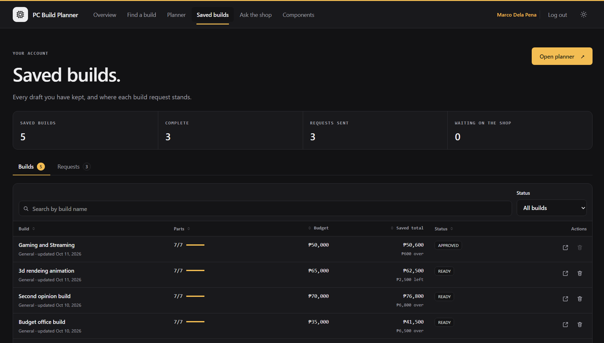
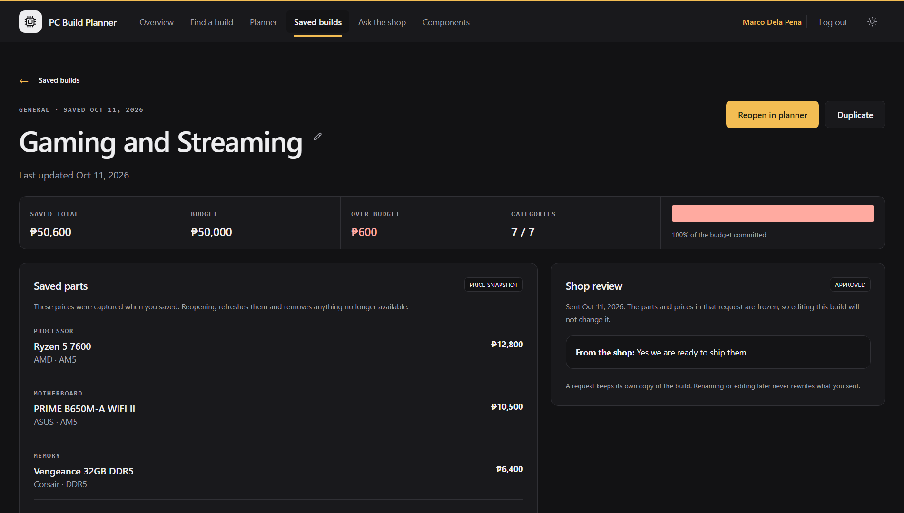
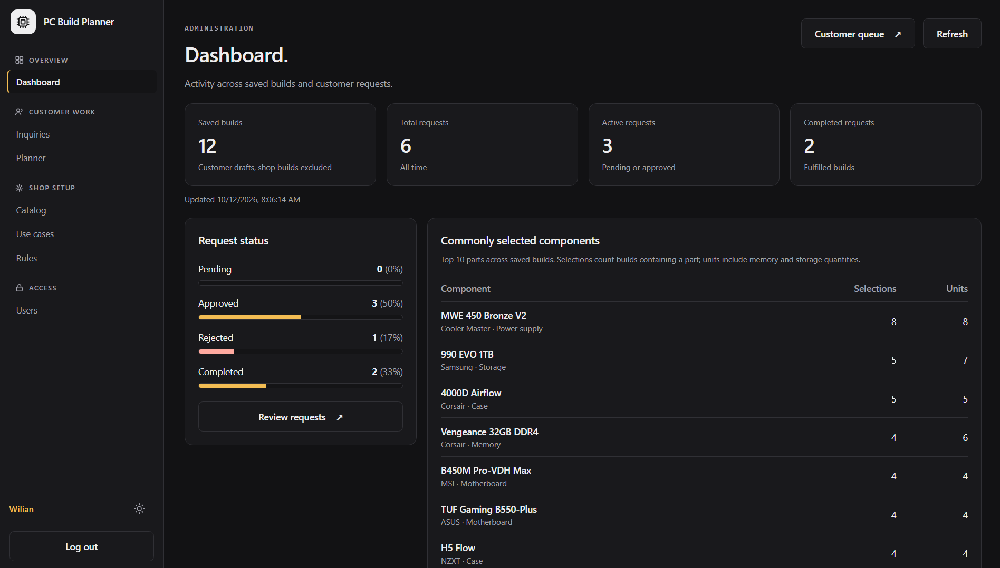
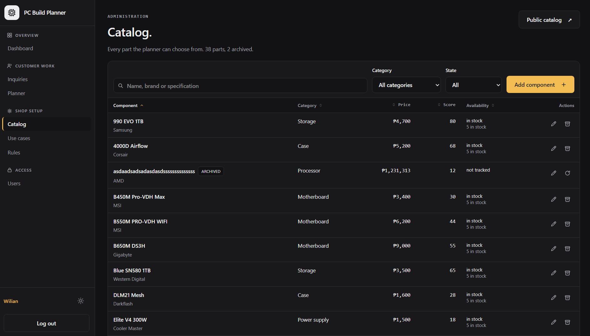
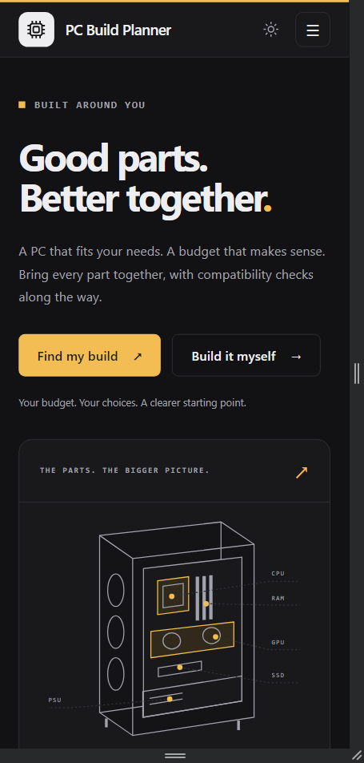

# PC Build Compatibility and Budget Planning System

CTADWEBL Advanced Web Programming, final project. National University Clark, A.Y. 2026 to 2027.

A MERN web application that helps a customer plan a desktop PC within a fixed budget, and lets a computer shop manage the catalog, the planning rules, and the build requests that come back.

## Group members

| Member | Contribution |
| --- | --- |
| Tyrone Joseph R. Salazar | Set up the npm workspace and the first four Mongoose models. Built the compatibility, quantity, power, budget allocation and recommendation services, the read-only catalog and profile endpoints, the five processing endpoints and the non-destructive seed. Built the first frontend pages, the light and dark themes and the neutral palette, the hero illustration, the category tabs and the budget meter. Added component photo metadata, the component picker, and the option-checking endpoint that disables incompatible parts before they can be chosen. Expanded the catalog from 20 to 34 records. |
| Jasper C. Tornos | Built the first account layer. Added the User model with normalized unique emails, hashed passwords, customer and admin roles and last-login timestamps, and the register, login, logout and current-user endpoints using JSON Web Tokens in HttpOnly cookies. Added the authentication and administrator middleware, credentialed CORS, and role updates that block self-demotion and demotion of the last administrator. Added the masked create-admin workflow, the login, registration, account and administrator pages, and the protected route guards. Set up the live Atlas connection and created the first administrator account. |
| Virger Jhonel V. Isla | Reworked the account layer onto User and Session models with salted scrypt hashing, opaque session cookies, hashed server-side tokens, expiry, revocation, origin protection and per-address attempt limits. Added the guest access rules, the administrator account list with role assignment, the first-admin bootstrap script and the combined account page. Added administrator component creation. Built the Build and BuildRequest models with owner scoping and immutable submission snapshots, the saved builds and build details pages with rename, duplicate and reopen at current prices, customer request submission, the administrator review queue with status transitions, and the reports dashboard. |
| Wilian Von Andrei P. Nunag | Completed catalog management with archive and restore, added use case profile and compatibility rule configuration, and built the build inquiry flow with the administrator planner and the landing page showcase. Rebuilt the administration console around a sidebar with shared table, dialog and icon components. Redesigned the customer side: navigation, footer, landing page, recommendation, saved builds, build details, inquiries and catalog, adding search, sorting, filtering and pagination. Moved form validation into Zod schemas behind React Hook Form, separated the request logger, origin guard and health route from the application entry point, and wrote the documentation. |

## The concept

A customer who wants to build a PC has two problems. They do not know which parts work together, and they do not know how to divide a fixed budget across seven parts. Buying a processor that does not fit the motherboard, or a power supply that cannot carry the graphics card, is a common and expensive mistake.

This system solves both. The customer enters a budget and a use case, and the system divides that budget across the seven tower categories and recommends a compatible set of parts. The customer can also build manually, and every part that would not fit is switched off before it can be chosen, with the reason shown. Finished builds are saved to the customer account and can be sent to the shop for review.

The shop side is a separate console. An administrator manages the catalog, the use case profiles and the compatibility rules, reviews customer requests, and answers customers whose use case no profile covers.

The seven categories are processor, motherboard, memory, graphics card, storage, case and power supply.

## What the application does, and what data it processes

The application does not only store and return records. Every screen the customer uses is driven by a calculation performed on the server.

**Budget division.** A budget and a use case produce a peso target for each of the seven categories, from percentage shares stored on the profile. Rounding is distributed so the targets always add back to the exact budget, with no peso lost. An administrator can pin any category to a fixed amount and the unpinned categories divide what is left.

**Compatibility evaluation.** A draft build is checked against four stored rules. The processor socket must match the motherboard socket, the memory type must match what the board supports, the case must accept the board's form factor, and the memory sticks must not outnumber the board's slots. Each produces a blocking error with wording the shop controls.

**Power estimation.** The draw of every selected part is totalled, a safety margin the shop sets is applied, and the result is compared with the supply's rating. A supply that cannot carry the build with headroom fails.

**Option evaluation.** Before a customer opens a picker, every candidate part in the catalog is run through the same rules against the current draft. Parts that cannot work come back marked with the reason, so the interface can disable them rather than letting a customer choose and then be told no.

**Performance balance.** Pairs of categories are compared by sample score. A gap wider than the stored threshold produces a warning, not an error, because an unbalanced build is still a valid build.

**Recommendation search.** Given a budget and a profile, the engine searches processor and motherboard platforms, then a graphics card, fills the remaining categories with the cheapest compatible parts, and spends what is left on priority upgrades. When no complete build fits, it reports the least expensive one that would.

**Request statistics and status rules.** The reports dashboard aggregates all-time saved build and request totals, a breakdown by status, and the ten most frequently selected parts with quantity-aware unit counts. Requests move through pending, approved, rejected and completed, and a stale transition is refused rather than silently applied.

## Screenshots

Landing page.



Manual planner with the component picker open. Parts that cannot work with the current draft are disabled, with the reason shown.



Saved builds, with search, sorting, a status filter and pagination.



Build details, showing the saved parts and the price snapshot taken when the build was saved.



Administration dashboard.



Catalog management.



Customer view at 375 pixels wide.



Earlier interface snapshots taken during development are also kept in `docs/`. They record how the design changed and do not reflect the current build.

## Setup

Requirements are Node.js 22.12 or newer and a MongoDB Atlas cluster. Run every command from the repository root. The project uses npm workspaces, so one install covers both folders.

```powershell
npm install
Copy-Item backend/.env.example backend/.env
Copy-Item backend/.env.example backend/env
# Open both files and set MONGO_URI to your own connection string.
npm run dev
```

The website runs on port 5173 and the API on port 3001. Open http://127.0.0.1:5173 and check http://127.0.0.1:3001/api/health, which answers `{ "database": "connected" }` when Atlas is reachable.

Use the same hostname for both. Session cookies are bound to the host, so opening the site on `localhost` while the API answers on `127.0.0.1` produces 401 responses that look like a login fault.

On Windows you can double-click `run-app.bat` instead. It starts both servers, reuses them if they are already running, and opens the site. That launcher reads `backend/env` rather than `backend/.env`, which is why both files are needed.

### Seeding

A new or empty database needs the sample catalog.

```powershell
npm run seed
```

This inserts the 34 sample components, the use case profiles, the four compatibility checks and the balance pairs. It only inserts records that are missing, so edits made inside the application are preserved.

### Demonstration data

```powershell
npm run seed:demo -w backend
```

Creates three customer accounts with eight saved builds and four requests covering every status. The accounts are on `@demo.pcbuildplanner.test` and share the password `DemoPass2026!`. Remove all of it with `npm run seed:demo -w backend -- --remove`. Every record it creates belongs to a demonstration account, so removing it leaves the real catalog untouched.

### First administrator

Registration always creates a customer. The first administrator is created by a script.

Add temporary `ADMIN_NAME`, `ADMIN_EMAIL` and `ADMIN_PASSWORD` values to `backend/env`, then run `npm run create-admin -w backend`. The password needs 12 to 128 characters. Remove those three values once the script succeeds. The script refuses to promote an account that already exists.

After that, sign in at `/auth`. An existing administrator can promote another account from `/admin/users`.

## Environment variables

`backend/.env` is read by the API and the seed scripts. `backend/env` holds the same values and is read by `run-app.bat` and the create-admin script. Both are ignored by Git. Database credentials never belong in a `VITE_` variable, because everything in the frontend build is public.

| Variable | File | Required | Default | Purpose |
| --- | --- | --- | --- | --- |
| `MONGO_URI` | `backend/.env` | Yes | none | Atlas connection string. The multi-host `mongodb://` form is accepted as well as `mongodb+srv://`. |
| `PORT` | `backend/.env` | No | `3001` | API port. |
| `CLIENT_ORIGIN` | `backend/.env` | No | `http://localhost:5173` | Allowed browser origin for CORS and the cross-site check. |
| `NODE_ENV` | `backend/.env` | No | none | Set to `production` to mark session cookies secure. |
| `ADMIN_NAME` | `backend/env` | Temporary | none | First administrator name. Remove after use. |
| `ADMIN_EMAIL` | `backend/env` | Temporary | none | First administrator email. Remove after use. |
| `ADMIN_PASSWORD` | `backend/env` | Temporary | none | First administrator password, 12 to 128 characters. Remove after use. |
| `VITE_API_URL` | `frontend/.env` | No | current hostname on port 3001 | API base URL for the browser. |

## API reference

Every path begins with `/api`. Requests and responses are JSON. Authentication uses an HttpOnly session cookie, so there is no token to attach by hand.

An item row is `{ "componentId": "<id>", "quantity": 1 }`. The server resolves components and derives every total, so a client cannot set an owner, a price or a total.

Errors return `{ "message": "..." }` and sometimes a `fields` object naming the inputs at fault. 200 is success, 201 is created, 204 is success with no body, 400 is invalid input, 401 is no session, 403 is the wrong role, 404 is a missing record, 409 is a conflict, 429 is too many sign-in attempts, 503 is the database being unreachable and 500 is an unexpected failure.

Sample responses below are shortened with an ellipsis where an array repeats.

### Public

| Method | Path | Purpose | Sample request | Sample response |
| --- | --- | --- | --- | --- |
| GET | `/health` | Database readiness | none | `{"database":"connected"}` |
| GET | `/components` | Active catalog | `?category=cpu&q=Ryzen` | `[{"_id":"6ac…570","name":"Ryzen 5 7600","brand":"AMD","category":"cpu","price":12800,"performanceScore":72,"availability":"in stock","stock":5,"socket":"AM5","powerDraw":65}, …]` |
| GET | `/components/:id` | One active component | none | `{"_id":"6ac…570","name":"Ryzen 5 7600","category":"cpu","price":12800, …}` |
| GET | `/showcase` | Builds the shop has published, up to 12 | none | `[{"id":"6ac…34b","name":"Office Build","budget":50000,"profileSlug":"office","items":[…],"total":49200,"imageUrl":"https://…"}, …]` |

### Accounts

Registration and sign-in share a limit of 20 attempts per address every 15 minutes.

| Method | Path | Access | Purpose | Sample request | Sample response |
| --- | --- | --- | --- | --- | --- |
| POST | `/auth/register` | Public | Create a customer | `{"name":"Marco Dela Pena","email":"marco@example.com","password":"MinimumTwelve1"}` | `{"id":"6ad…b21","name":"Marco Dela Pena","email":"marco@example.com","role":"customer"}` |
| POST | `/auth/login` | Public | Start a seven-day session | `{"email":"marco@example.com","password":"MinimumTwelve1"}` | `{"id":"6ad…b21","name":"Marco Dela Pena","role":"customer"}` |
| GET | `/auth/me` | Signed in | The current account | none | `{"id":"6ad…b21","name":"Marco Dela Pena","role":"customer"}` |
| POST | `/auth/logout` | Signed in | Revoke the session | none | `204`, no body |

### Planning engine

Any signed-in account may use these. They read configuration or run the engine, and administrators need them to answer inquiries.

| Method | Path | Purpose | Sample request | Sample response |
| --- | --- | --- | --- | --- |
| GET | `/profiles` | Active use case profiles | none | `[{"slug":"gaming","label":"Gaming","description":"Competitive gaming at 1080p.","isDefault":true,"allocations":[…],"minimums":[…]}, …]` |
| GET | `/profiles/:slug` | One profile | none | `{"slug":"gaming","label":"Gaming","allocations":[{"category":"gpu","percent":30,"priority":1}, …]}` |
| POST | `/allocations` | Divide a budget across the seven categories | `{"budget":50000,"profileSlug":"gaming","locks":{"gpu":20000}}` | `[{"category":"gpu","percent":40,"allocated":20000,"priority":1},{"category":"cpu","percent":22,"allocated":6600,"priority":2}, …]` |
| POST | `/recommendations` | A compatible build inside the budget | `{"budget":50000,"profileSlug":"gaming"}` | `{"feasible":true,"items":[…],"allocations":[…],"validation":{…},"remaining":3000,"message":"A compatible build within your total budget. …"}` |
| POST | `/validations` | Check a draft | `{"items":[{"componentId":"6ac…570","quantity":1}, …]}` | `{"valid":false,"missingCategories":["case"],"issues":[{"code":"MEMORY_TYPE_MATCH","severity":"error","message":"This board takes DDR4; the memory is DDR5."}],"power":{…},"total":38200}` |
| POST | `/power-calculations` | Draw, required wattage and whether the supply covers it | `{"items":[…]}` | `{"totalDraw":295,"marginPercent":30,"requiredWattage":384,"supplyRating":450,"sufficient":true}` |
| POST | `/balance-assessments` | Performance gap warnings | `{"items":[…]}` | `{"issues":[{"code":"CPU_GPU_BALANCE","severity":"warning","message":"The graphics card is far ahead of the processor."}]}` |
| POST | `/component-options` | Evaluate every catalog candidate against the draft | `{"items":[…],"category":"memory"}` | `[{"componentId":"6ac…66b","compatible":false,"available":true,"reasons":["This board takes DDR4; the memory is DDR5."]}, …]` |

### Saved builds

Any signed-in account, scoped to the owner. A build belonging to someone else returns 404, not 403.

| Method | Path | Purpose | Sample request | Sample response |
| --- | --- | --- | --- | --- |
| GET | `/builds` | Own saved builds, newest update first | none | `[{"id":"6ac…34b","name":"Gaming draft","budget":50000,"total":47000,"items":[…]}, …]` |
| POST | `/builds` | Save a draft | `{"name":"Gaming draft","budget":50000,"profileSlug":"gaming","items":[…]}` | `201` `{"id":"6ac…34b","name":"Gaming draft","total":47000, …}` |
| GET | `/builds/:id` | One build with its stored prices | none | `{"id":"6ac…34b","name":"Gaming draft","items":[{"component":{…},"quantity":1}, …],"total":47000}` |
| PUT | `/builds/:id` | Replace the saved draft | `{"name":"Gaming draft","budget":55000,"profileSlug":"gaming","items":[…]}` | `{"id":"6ac…34b","budget":55000,"total":47000, …}` |
| PATCH | `/builds/:id` | Rename | `{"name":"Streaming build"}` | `{"id":"6ac…34b","name":"Streaming build", …}` |
| DELETE | `/builds/:id` | Delete. Refused while a request is open | none | `204`, or `409` `{"message":"This build has a request under review."}` |
| PATCH | `/builds/:id/visibility` | Administrator only. Publish or hide, and set the landing-page photo | `{"visibility":"published","imageUrl":"https://example.com/tower.jpg"}` | `{"id":"6ac…34b","imageUrl":"https://example.com/tower.jpg", …}` |
| POST | `/builds/:id/duplicate` | Copy, keeping the stored prices | none | `201` `{"id":"6ae…901","name":"Gaming draft (copy)", …}` |
| POST | `/builds/:id/reopen` | Return the build at current prices | none | `{"plan":{"budget":50000,"items":[…]},"notices":["990 EVO 1TB is no longer available and was removed."]}` |

### Build requests

Submission re-checks the live catalog. All seven categories must be present, the supported checks must pass, and the parts must be available in the quantity asked for. Each request stores its own snapshot, so later edits to the saved build never change what was sent.

| Method | Path | Access | Purpose | Sample request | Sample response |
| --- | --- | --- | --- | --- | --- |
| GET | `/requests` | Customer | Own requests, latest 200 | none | `[{"id":"6b0…77a","buildId":"6ac…34b","status":"pending","note":"","remarks":"","snapshot":{"name":"Gaming draft","total":47000,"items":[…]}}, …]` |
| POST | `/requests` | Customer | Submit a saved build | `{"buildId":"6ac…34b","note":"No rush."}` | `201` `{"id":"6b0…77a","status":"pending","snapshot":{…}}` |
| GET | `/admin/requests` | Administrator | All requests with customer identity | none | `[{"id":"6b0…77a","status":"pending","owner":{"id":"6ad…b21","name":"Marco Dela Pena","email":"marco@example.com"},"snapshot":{…}}, …]` |
| GET | `/admin/reports` | Administrator | Totals, status breakdown and the top ten parts | none | `{"savedBuildCount":8,"requestCount":4,"activeRequestCount":2,"statusCounts":{"pending":1,"approved":1,"rejected":1,"completed":1},"commonComponents":[…],"generatedAt":"2026-10-12T02:14:00.000Z"}` |
| PATCH | `/admin/requests/:id/status` | Administrator | Move a request on | `{"status":"approved","remarks":"Parts confirmed.","expectedStatus":"pending"}` | `{"id":"6b0…77a","status":"approved","remarks":"Parts confirmed."}` |

### Build inquiries

| Method | Path | Access | Purpose | Sample request | Sample response |
| --- | --- | --- | --- | --- | --- |
| GET | `/inquiries` | Customer | Own inquiries, latest 200 | none | `[{"id":"6b2…1c4","useCase":"3D rendering","budget":80000,"status":"open","reply":"","proposedBuildId":null}, …]` |
| POST | `/inquiries` | Customer | Ask the shop to build it | `{"useCase":"3D rendering","budget":80000,"details":"I already have a monitor."}` | `201` `{"id":"6b2…1c4","status":"open","useCase":"3D rendering","budget":80000}` |
| GET | `/inquiries/:id` | Customer owner | One inquiry with the proposed build | none | `{"id":"6b2…1c4","status":"answered","reply":"This stays under budget.","proposal":{"name":"Rendering build","total":78400,"items":[…]}}` |
| PATCH | `/inquiries/:id/accept` | Customer owner | Copy the proposal into the account | none | `{"message":"Saved to your builds.","acceptedBuildId":"6b3…5e0"}` |
| PATCH | `/inquiries/:id/decline` | Customer owner | Decline the proposal | none | `{"message":"Inquiry declined."}` |
| GET | `/admin/inquiries` | Administrator | All inquiries | `?status=open` | `[{"id":"6b2…1c4","useCase":"3D rendering","budget":80000,"status":"open","customer":{"id":"6ad…b21","name":"Marco Dela Pena"}}, …]` |
| GET | `/admin/inquiries/:id` | Administrator | One inquiry with the customer and the proposal | none | `{"id":"6b2…1c4","useCase":"3D rendering","customer":{…},"proposal":null}` |
| PATCH | `/admin/inquiries/:id/propose` | Administrator | Send a parts list and a reply | `{"items":[…],"budget":80000,"name":"Rendering build","reply":"This stays under budget."}` | `{"id":"6b2…1c4","status":"answered","proposedBuildId":"6b3…4af"}` |
| PATCH | `/admin/inquiries/:id/close` | Administrator | Close the inquiry | `{"reply":"We cannot source these parts right now."}` | `{"id":"6b2…1c4","status":"closed","reply":"We cannot source these parts right now."}` |

### Catalog administration

| Method | Path | Purpose | Sample request | Sample response |
| --- | --- | --- | --- | --- |
| GET | `/admin/components` | Full catalog including archived parts | none | `[{"_id":"6ac…570","name":"Ryzen 5 7600","archived":false, …}, …]` |
| POST | `/admin/components` | Create a component | `{"name":"MasterBox NR200P","brand":"Cooler Master","category":"case","price":4800,"performanceScore":26,"powerDraw":6,"stock":5,"availability":"in stock","supportedFormFactors":["ITX"]}` | `201` `{"_id":"6c1…9d2","name":"MasterBox NR200P", …}`, or `409` `{"message":"That brand and name already exist.","fields":{"name":"…"}}` |
| PUT | `/admin/components/:id` | Update. Specifications the new category does not use are cleared | `{"name":"MasterBox NR200P","brand":"Cooler Master","category":"case","price":4600, …}` | `{"_id":"6c1…9d2","price":4600, …}` |
| DELETE | `/admin/components/:id` | Archive. Saved builds reference parts by id, so nothing is removed | none | `{"_id":"6c1…9d2","archived":true}` |
| PATCH | `/admin/components/:id/restore` | Return it to the active catalog | none | `{"_id":"6c1…9d2","archived":false}` |

### Shop configuration

| Method | Path | Purpose | Sample request | Sample response |
| --- | --- | --- | --- | --- |
| GET | `/admin/rules` | The four checks and every balance pair | none | `{"checks":[{"code":"PSU_WATTAGE_HEADROOM","label":"Power headroom","message":"The PSU must cover total draw plus the safety margin.","marginPercent":30}, …],"pairs":[…]}` |
| PUT | `/admin/rules/checks/:code` | Reword a check, and set the margin on the power check | `{"label":"Power headroom","message":"The supply must cover the draw plus headroom.","marginPercent":30}` | `{"code":"PSU_WATTAGE_HEADROOM","marginPercent":30, …}` |
| POST | `/admin/rules/pairs` | Add a balance pair | `{"categoryA":"cpu","categoryB":"gpu","maxGap":25}` | `201` `{"_id":"6c4…10a","categoryA":"cpu","categoryB":"gpu","maxGap":25,"active":true}` |
| PUT | `/admin/rules/pairs/:id` | Update a balance pair | `{"categoryA":"cpu","categoryB":"gpu","maxGap":30}` | `{"_id":"6c4…10a","maxGap":30}` |
| DELETE | `/admin/rules/pairs/:id` | Remove a balance pair | none | `204`, no body |
| GET | `/admin/profiles` | Every use case profile including archived ones | none | `[{"_id":"6c5…772","slug":"gaming","label":"Gaming","isDefault":true,"active":true,"allocations":[…]}, …]` |
| POST | `/admin/profiles` | Create a profile | `{"slug":"editing","label":"Video editing","description":"4K timeline work.","allocations":[{"category":"cpu","percent":25,"priority":1}, …],"minimums":[{"category":"memory","value":32}]}` | `201` `{"_id":"6c6…118","slug":"editing", …}` |
| PUT | `/admin/profiles/:id` | Update a profile | `{"slug":"editing","label":"Video editing","allocations":[…],"minimums":[…]}` | `{"_id":"6c6…118","label":"Video editing", …}` |
| PATCH | `/admin/profiles/:id/default` | Make it the default | none | `{"_id":"6c6…118","isDefault":true}` |
| DELETE | `/admin/profiles/:id` | Archive. The default and the last active profile are refused | none | `{"_id":"6c6…118","active":false}`, or `409` `{"message":"Choose another default first."}` |
| PATCH | `/admin/profiles/:id/restore` | Reactivate it | none | `{"_id":"6c6…118","active":true}` |

### Accounts administration

| Method | Path | Purpose | Sample request | Sample response |
| --- | --- | --- | --- | --- |
| GET | `/admin/users` | Latest 500 accounts | none | `[{"id":"6ad…b21","name":"Marco Dela Pena","email":"marco@example.com","role":"customer","createdAt":"…"}, …]` |
| PATCH | `/admin/users/:id/role` | Change a role. Revokes that account's sessions | `{"role":"admin"}` | `{"id":"6ad…b21","role":"admin"}`, or `409` `{"message":"The last administrator cannot be demoted."}` |

That is 57 endpoints in total.

## Features

### Customer

- Register, sign in and sign out. Sessions last seven days.
- Browse the component catalog with search, a five-way sort, category tabs and pagination. Open to visitors who have not signed in.
- Get a recommended build from a budget and a use case. When the budget cannot produce a complete build, the system reports the minimum known cost.
- Plan a build manually. Incompatible and unavailable parts are disabled in the picker before they can be chosen, with the reason shown.
- Pin a peso target on any category and let the rest divide what is left.
- Watch the budget meter, the running total and the compatibility result change as parts are chosen.
- Print a build sheet.
- Save a build, rename it, duplicate it, delete it, and reopen it at current catalog prices.
- Submit a saved build to the shop and follow its status.
- Send an inquiry when no use case fits, then accept or decline the parts list the shop sends back. Accepting copies that build into the customer account.
- Open a build the shop published and start a plan from it.

### Administrator

- A separate console with a grouped sidebar that becomes a menu below 1024 pixels.
- Catalog management with create, edit, archive and restore. Every list is a table with search, sorting, filtering and pagination.
- Use case profiles, including the budget share per category, the priority order and which profile is the default.
- Compatibility rules. The wording of the four hard checks and the power safety margin can be changed, and balance pairs are fully managed.
- A customer queue with two tabs, build inquiries and review requests.
- Answer an inquiry with a full parts list, built in the same planner the customers use.
- Publish a build to the landing page with a photo of a finished unit, then edit or unpublish it.
- A dashboard with saved build and request totals, a status breakdown and the ten most commonly selected parts.
- Account list and role changes. Role changes revoke sessions, and the last administrator cannot be demoted.

### Compatibility rules

Four checks block a build.

| Check | Rule |
| --- | --- |
| `CPU_SOCKET_MATCH` | The processor socket must match the motherboard socket. |
| `MEMORY_TYPE_MATCH` | The memory type must match what the motherboard supports. |
| `CASE_FITS_BOARD` | The case must accept the motherboard form factor. |
| `PSU_WATTAGE_HEADROOM` | The power supply must cover the estimated draw plus the safety margin. |

A quantity check also blocks a build when the memory sticks outnumber the motherboard slots. Balance pairs produce warnings rather than errors, because a large performance gap between two parts is worth knowing about but remains the customer's decision.

## Pages

Fifteen pages. Three are public, five are customer only and seven are administrator only. `/login` and `/register` redirect to `/auth`, and any unknown URL redirects home.

| Path | Access | Page |
| --- | --- | --- |
| `/` | Public | Landing page with the published build showcase |
| `/components` | Public | Component catalog |
| `/auth` | Public | Sign in and register |
| `/recommend` | Customer | Budget and use case recommendation |
| `/builder` | Customer | Manual planner |
| `/builds` | Customer | Saved builds and request history |
| `/builds/:id` | Customer | Build details |
| `/help` | Customer | Ask the shop |
| `/admin/reports` | Administrator | Dashboard |
| `/admin/inquiries` | Administrator | Customer queue |
| `/admin/plan` | Administrator | Shop planner and published builds |
| `/admin/components` | Administrator | Catalog |
| `/admin/profiles` | Administrator | Use case profiles |
| `/admin/rules` | Administrator | Compatibility rules |
| `/admin/users` | Administrator | Accounts |

## Data models

Nine collections, all with timestamps.

| Model | Holds | References |
| --- | --- | --- |
| `Component` | A catalog part, its price, power draw, sample score, stock and category specifications | none |
| `AllocationProfile` | A use case and its budget share across the seven categories | none |
| `CheckSetting` | The wording and margin of one of the four hard checks | none |
| `BalancePair` | Two categories to compare and the acceptable score gap | none |
| `User` | An account, its role and a salted password hash | none |
| `Session` | A hashed session token and its expiry | `User` |
| `Build` | A saved build, its budget, total, part snapshots and landing-page photo | `User`, `AllocationProfile`, `Component` |
| `BuildRequest` | A submission, its status, remarks and an immutable snapshot | `User` owner, `Build`, `User` reviewer |
| `BuildInquiry` | A customer question, its status and the shop's reply | `User` customer, `Build` proposed, `Build` accepted, `User` responder |

`Build` and `BuildRequest` are the two entities that exchange data. A customer saves a `Build`, submits it, and the `BuildRequest` copies the parts and prices at that moment. The shop then moves that request through its statuses while the customer keeps editing the original build. The two stay linked through their reference but never overwrite each other, which is the point of the snapshot.

Embedded item snapshots sit alongside the component references on purpose. The reference answers which part this is. The snapshot answers what it cost on the day it was chosen.

## Testing

```powershell
npm test
```

Thirty backend tests across six files cover the planning engine, component options, authentication, saved builds, catalog administration and request reporting. The frontend is checked by `npm run build`, which runs strict TypeScript and the production Vite build.

Three test assertions were updated when the planning engine and the saved build routes moved from customer only to any signed-in account. Each change is commented in place. The rule the tests encoded was replaced by a deliberate design decision, which is different from editing a test to hide a failure.

## Known limitations

These are deliberate. Most are scope or time decisions rather than oversights.

**Compatibility scope.** The system checks sockets, memory type, case fit, power headroom and memory slot count. It does not check BIOS support, storage connectors, graphics card clearance, power supply cables, cooling or case airflow. Matching sockets does not guarantee a processor will boot without a BIOS update.

**The four hard checks cannot be switched off.** An administrator can reword them, but the engine ignores the active flag. A shop should not be able to sell a processor that does not fit its motherboard. The memory slot check has no stored wording for the same reason.

**No draft persistence across a refresh.** An unsaved draft survives navigation inside the session but not a page reload, and the planner says so. A restored draft would show prices that may no longer be current. Saving the build is the supported way to keep one.

**Form validation covers every form but not every inline editor.** All six forms use React Hook Form with a Zod schema from `frontend/src/schemas`. The four compatibility checks on the rules page are edited in place with one save button each and no form element, so they validate against the same Zod schema without React Hook Form.

**Folder names.** The workspaces are `frontend/` and `backend/` rather than client and server. Renaming them breaks npm workspaces, `run-app.bat` and every path in the documentation.

**A discrete graphics card is always required.** All seven categories must be filled for a build to be complete, so builds using integrated graphics are not supported.

**Recommendations are a heuristic.** The engine searches for a feasible build and spends what is left on priority upgrades. It does not claim to be the best possible build for the money, and category locks are budget targets rather than hard caps during those upgrades.

**Sample data.** Prices and performance scores are illustrative values for coursework, not a live price feed. Score gaps are rough indicators, not benchmark results. Memory capacity is treated as capacity per selectable unit, so a catalog needs one consistent stick or kit convention before real use.

**No stock reservation.** A submitted request does not hold or deduct stock. Availability is checked at submission only. There is no cart, no payment and no order fulfilment.

**Photos are external.** Component images and published build photos come from manufacturer and retailer URLs, so the catalog needs internet access to show them. A failed image shows an unavailable state rather than a broken icon.

**Production notes.** The sign-in rate limiter counts per server process, so a multi-instance deployment needs a shared limiter and trusted proxy settings. Production also needs HTTPS and same-site hosting for the website and the API, or an `/api` reverse proxy.

**List caps.** Requests and inquiries show the latest 200, accounts the latest 500, and the landing page showcase 12 builds. The interface labels each cap.

## Project structure

```
PCBuildPlanner/
  backend/          Express API
    config/         database connection
    data/           sample catalog and component photos
    middleware/     authentication, request logger, origin guard, error handling
    models/         nine Mongoose schemas
    routes/         nine routers
    services/       planning engine, validation, input checking
    tests/          30 Node test-runner tests
  frontend/         React, Vite, TypeScript
    src/pages/      15 pages
    src/components/ shared table, dialog, icons, number field, summaries
    src/hooks/      table state, API, theme, component options
    src/schemas/    six Zod schemas
    src/types/      shared contracts with the API
  docs/             setup notes and screenshots
```

`app.js` holds configuration and mounting only. The request logger, the cross-site write guard and the health route are separate modules, and the JSON not-found handler and the error handler are registered last, in that order.

Shared frontend contracts live in `frontend/src/types/index.ts` and `frontend/src/types/builds.ts`. Update them alongside any backend schema change.

Three shared frontend pieces are worth reusing rather than rebuilding. `hooks/useTableState.ts` handles search, three-state sorting and pagination. `components/DataTable.tsx` renders the toolbar, sortable headers, pagination and empty states, and its columns accept `hideBelow` to drop out on narrow screens. `components/Drawer.tsx` is a centred dialog that becomes a bottom sheet below 640 pixels, with a focus trap and a focus return.

## Further reading

[docs/SETUP.md](docs/SETUP.md) has the step-by-step Atlas and GitHub setup.
[CONTEXT.md](CONTEXT.md) describes the current implementation for teammates.
[CHANGELOG.md](CHANGELOG.md) records what changed and when.
